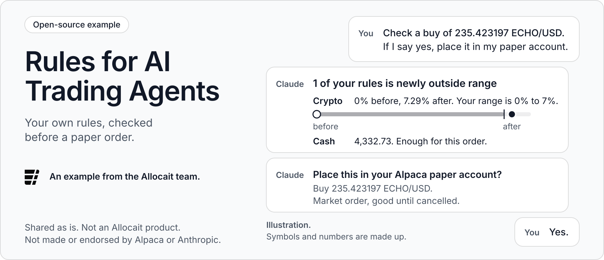
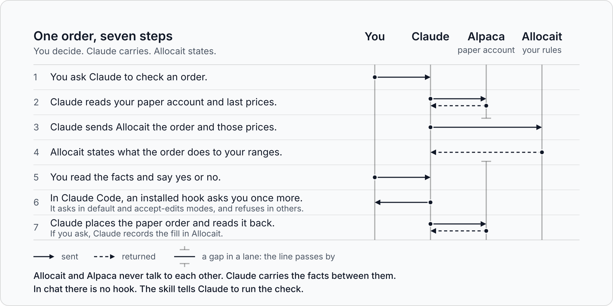

<picture>
  <source media="(prefers-color-scheme: dark)" srcset="images/hero-dark.svg">
  
</picture>

# Rules for AI Trading Agents

**Your own rules, checked before a paper order.**

You write your rules in Allocait. Before Claude places an order in your Alpaca paper account, it checks the order against those rules, tells you what it found, and asks you first. You need an Alpaca paper account, an Allocait account and Claude, and each has its own terms. Setup takes a few minutes.

An open-source example from the Allocait team, shared as is under the MIT license. It is not an Allocait product or service. Alpaca and Anthropic didn't make it and don't sponsor or endorse it.

Allocait checks your holdings against rules you wrote. It does not give investment advice or recommend trades.

## Three prompts

After [Set up](#set-up), paste these into Claude, in order.

1. **Copy your account.** `Mirror my Alpaca paper account into Allocait, then ask me for my ranges.` Claude shows a table of what it will write, names what it leaves out, and waits for your yes. Then it asks for each range in your words and writes none of its own. Options, short stock and your active scenario are in [docs/ALPACA.md](docs/ALPACA.md).
2. **Check an order.** `Check an order to buy 5 shares of <a symbol you hold or follow> against my rules. If I say yes, place it in my paper account and record the fill.` Replace the placeholder with your own symbol. This needs the ranges from prompt 1. Claude gets the prices from Alpaca, runs the check, states the facts, asks, places the order, reads it back, and records what filled. In Claude Code, if the hook is installed and the permission mode can ask, the hook asks once more before the order tool runs.
3. **See where you stand.** `Where does my Alpaca account stand against my Allocait rules?` Claude only reads. For a schedule, see [docs/ALPACA.md](docs/ALPACA.md).

## What you will see

A sketch built on the made-up ECHO/USD example, not output from a run. The hook's question uses the wording the script prints (run on a made-up transcript); how Claude Code lays it out on screen is UNVERIFIED. `node check.mjs --demo` prints a larger, two-leg saved result.

```
You     Check an order to buy 235.423197 ECHO/USD against my rules.
        If I say yes, place it in my paper account and record the fill.
Claude  I read your Alpaca paper account and the last trade for ECHO/USD
        (3.19, from Alpaca, with its time), and sent both to Allocait:
          Rules this order puts newly or further outside range: 1
          Crypto band: 0% before, 7.29% after (your range is 0% to 7%)
          Not covered by any rule of yours: ECHO/USD has no size range
          Cash: 4,332.73 before, 3,581.73 after, enough for the order
        Place this in your Alpaca paper account?
        Buy 235.423197 ECHO/USD, market order, good until cancelled.
You     Yes.
Hook    (Claude Code only, before the order tool runs)
        This call places BUY ECHO/USD 235.423197 shares. It matches an unused
        check_trades result in this session. That result names 1 rule newly or
        further outside range: Crypto band 0% -> 7.29% (range 0% to 7%),
        newly outside.
Claude  Alpaca acknowledged the order. Read back: status filled, filled_qty
        235.423197, filled_avg_price 3.19. Recorded in Allocait.
```

## How it works

<picture>
  <source media="(prefers-color-scheme: dark)" srcset="images/flow-dark.svg">
  
</picture>

1. You ask Claude to check an order.
2. Claude reads your paper account and last prices from Alpaca.
3. Claude sends Allocait the order and those prices.
4. Allocait states what the order does to your ranges.
5. You read the facts and say yes or no.
6. In Claude Code with the hook installed, the hook asks you once more, in default and accept-edits modes; in other modes it refuses the call. In chat there is no hook: the skill tells Claude to run the check.
7. Claude places the paper order and reads it back. If you ask, Claude records the fill in Allocait.

Allocait is not a broker. It places no order, moves no money and supplies no prices. Claude places the paper order through Alpaca, and the skill tells it to wait for your yes.

| Following the skill, Claude does | Following the skill, Claude does not |
| --- | --- |
| Read your Alpaca paper account | Place an order before your yes |
| Ask Allocait which of your own rules an order would put outside range | Give advice, pick a trade, or suggest a number for your rules |
| Tell you the facts and the prices it used, with source and time | Use a price from memory |
| Place a paper order after your yes, then read it back | Call `close_all_positions`, `cancel_all_orders` or `update_account_config` |
| Record the fill in Allocait when you ask | Move money: the record is in Allocait only |

## Questions

- **Does it trade for me?** Not on its own. Claude can place one paper order in your Alpaca paper account, after you say yes to that exact order. Allocait places no order and moves no money. The script in this folder can place a live order only with three explicit settings, see [docs/SCRIPT.md](docs/SCRIPT.md).
- **Does it work on a live account?** The skill tells Claude to place orders only through the Paper Trading connector. It may read where a live account stands with Alpaca's Live connector. What that connector can do beyond reads is UNVERIFIED here. A self-hosted Alpaca server with live keys places live orders, so use paper keys.
- **What is a range?** A minimum and a maximum that you write for an asset class or for one holding, as a percent of your account. Claude asks you for every number and writes none of its own.

## Set up

You need an [Alpaca paper account](https://app.alpaca.markets/signup), an Allocait account (allocait.app) and Claude.

**In Claude Code** (2.1.295 or later, and `node` on your `PATH` for the hook):

1. Add the Alpaca Paper Trading connector from the Claude directory (claude.ai/directory/alpaca-paper-trading) and sign in with Alpaca. Without a claude.ai login, see [docs/ALPACA.md](docs/ALPACA.md).
2. If `/mcp` already lists Allocait, skip this step. Otherwise run `claude mcp add --transport http allocait https://api.allocait.app/functions/v1/mcp`, then `/mcp`, pick `allocait` and sign in. On the consent screen, choose Read and change, because prompts 1 and 2 write to Allocait. Checks and prompt 3 need only Read. Claude Code asks before each tool's first use, so expect a few permission prompts.
3. Install the skill and the hook:

   ```
   /plugin marketplace add allocait-app/ai-trading-agent-rules
   /plugin install ai-trading-agent-rules@allocait-examples
   ```

   In a session, `/plugin install` opens the plugin's panel so you can pick a scope. Run `/reload-plugins` if Claude Code says to. From a clone of this repo, `claude --plugin-dir .` loads the same plugin for one session.

**In claude.ai chat or Claude's desktop chat** (not Claude Code) there is no hook, so nothing refuses an order that should have been checked. Add the two connectors, download `ai-trading-agent-rules.zip` from this repo, and add it under Customize > Skills > Upload a skill. Turn on code execution, which skills need. The skill runs a small Node script for arithmetic. If Claude cannot run it, the skill says to do the arithmetic by hand and show the numbers (not tried here). Claude Code on the desktop and on the web is Claude Code, so use the steps above. A cloud session does not load a plugin you installed on your machine.

## What it writes

| Where | What | When |
| --- | --- | --- |
| Alpaca | One paper order | Only after your yes in the chat |
| Allocait | A portfolio, its holdings and cash, and its Allow shorts setting when the account holds a short. What it leaves out is named in the table, and listed in [docs/ALPACA.md](docs/ALPACA.md) | When you ask for a mirror, after you see the table and say yes (a second yes for Allow shorts) |
| Allocait | The fill of an order | When you ask, after the order is read back, at the quantity and price that filled |

This records the change in Allocait only. It moves no money and places no order. With no one present, a run writes nothing and lists what it would change.

`check_trades` uses the prices you send for that call only and stores none. A mirror or a recorded fill saves each holding's price on its ledger row in Allocait, so those are Alpaca prices kept in your account. Alpaca's data, account and orders follow your agreement with Alpaca, so check its terms for what you may keep.

**Reading a result.** A result inside every range does not say a change is advisable. Allocait cannot approve, stop or place an order. The check is arithmetic on your rules, the holdings you recorded and the prices Claude sent. It judges the book Allocait holds, so the skill compares share counts with Alpaca's and offers a mirror when they differ. The fields are in [docs/SCRIPT.md](docs/SCRIPT.md).

## Terms

- **Range:** the least and the most you allow, as a percent of your account, for an asset class or for one holding in it.
- **Mirror:** copying what your Alpaca paper account holds into Allocait so a check has something to read. It changes nothing in Alpaca.
- **Check:** Allocait comparing a proposed order with your ranges and stating which it would put outside range. It decides nothing.
- **Hook:** a script on your machine that Claude Code runs before an order tool. It refuses a tool call that has no matching check in the session. It does not promise to stop an order, and [docs/HOOK.md](docs/HOOK.md) lists what it cannot do.
- **Paper account:** Alpaca's practice account. Orders there are simulated.

## Files

| Path | What it is |
| --- | --- |
| `skills/ai-trading-agent-rules/` | The skill (`SKILL.md`, `OPTIONS-SHORTS.md`) and `book.mjs`, its arithmetic |
| `ai-trading-agent-rules.zip` | The same folder, for Customize > Skills > Upload a skill |
| `.claude-plugin/`, `hooks/` | The plugin manifests; the order hook and its Alpaca rules |
| `docs/` | [HOOK.md](docs/HOOK.md) (the hook and its limits), [ALPACA.md](docs/ALPACA.md) (dated Alpaca facts, what the skill leaves out), [SCRIPT.md](docs/SCRIPT.md) (the script bot, exit codes, result fields) |
| `images/`, `brand/` | The pictures on this page; the [brand sheet](brand/BRAND.md), icon, lockup and social preview |
| `check.mjs`, `bot.mjs`, `lib/`, `strategy.mjs`, `python/`, `tool.json` | The script path, in Node and Python |
| `*.example.json`, `test/`, `scripts/` | Examples, offline tests (`npm test`, `npm run test:py`), `npm run skill:zip` |
| `AGENTS.md` | Instructions for a coding agent working in a clone |

The plugin is the whole folder, because the marketplace entry's source is `./`. API reference: https://allocait.app/docs/api/. Report a security problem as `SECURITY.md` says.

## License

MIT. Provided as is under the license, see `LICENSE`. Alpaca and Claude are the names of their owners and appear only to say what this works with.
