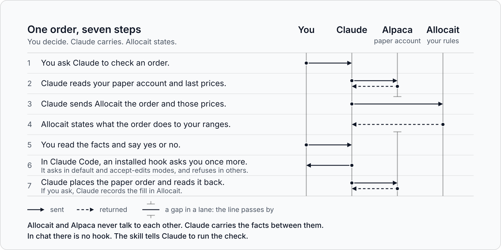

# How it works

Reference for [Rules for AI Trading Agents](../README.md). You do not need it to get started.

## A run, start to finish

<picture>
  <source media="(prefers-color-scheme: dark)" srcset="../images/flow-dark.svg">
  
</picture>

1. You ask Claude to check an order.
2. Claude reads your paper account and last prices from Alpaca.
3. Claude sends Allocait the order and those prices.
4. Allocait states what the order does to your ranges.
5. You read the facts and say yes or no.
6. In Claude Code with the hook installed, the hook asks you once more, in default and accept-edits modes; in other modes it refuses the call. In chat there is no hook: the skill tells Claude to run the check.
7. Claude places the paper order and reads it back. If you ask, Claude records the fill in Allocait.

Allocait is not a broker. It places no order, moves no money and supplies no prices. Claude places the paper order through Alpaca, and the skill tells it to wait for your yes.

| Following the skill, Claude does | Following the skill, Claude does not |
| --- | --- |
| Read your Alpaca paper account | Place an order before your yes |
| Ask Allocait which of your own rules an order would put outside range | Give advice, pick a trade, or suggest a number for your rules |
| Tell you the facts and the prices it used, with source and time | Use a price from memory |
| Place a paper order after your yes, then read it back | Call `close_all_positions`, `cancel_all_orders` or `update_account_config` |
| Record the fill in Allocait when you ask | Move money: the record is in Allocait only |

## What you will see

A sketch built on the made-up ECHO/USD example, not output from a run. The hook's question uses the wording the script prints (run on a made-up transcript); how Claude Code lays it out on screen is UNVERIFIED. `node script/check.mjs --demo` prints a larger, two-leg saved result.

```
You     Check an order to buy 235.423197 ECHO/USD against my rules.
        If I say yes, place it in my paper account and record the fill.
Claude  I read your Alpaca paper account and the last trade for ECHO/USD
        (3.19, from Alpaca, with its time), and sent both to Allocait:
          Rules this order puts newly or further outside range: 1
          Crypto band: 0% before, 7.29% after (your range is 0% to 7%)
          Not covered by any rule of yours: ECHO/USD has no size range
          Cash: 4,332.73 before, 3,581.73 after, enough for the order
        Place this in your Alpaca paper account?
        Buy 235.423197 ECHO/USD, market order, good until cancelled.
You     Yes.
Hook    (Claude Code only, before the order tool runs)
        This call places BUY ECHO/USD 235.423197 shares. It matches an unused
        check_trades result in this session. That result names 1 rule newly or
        further outside range: Crypto band 0% -> 7.29% (range 0% to 7%),
        newly outside.
Claude  Alpaca acknowledged the order. Read back: status filled, filled_qty
        235.423197, filled_avg_price 3.19. Recorded in Allocait.
```

## What it writes

| Where | What | When |
| --- | --- | --- |
| Alpaca | One paper order | Only after your yes in the chat |
| Allocait | A portfolio, its holdings and cash, and its Allow shorts setting when the account holds a short. What it leaves out is named in the table, and listed in [ALPACA.md](ALPACA.md) | When you ask for a mirror, after you see the table and say yes (a second yes for Allow shorts) |
| Allocait | The fill of an order | When you ask, after the order is read back, at the quantity and price that filled |

With no one present, a run writes nothing and lists what it would change.

`check_trades` uses the prices you send for that call only and stores none. A mirror or a recorded fill saves each holding's price on its ledger row in Allocait, so those are Alpaca prices kept in your account. Alpaca's data, account and orders follow your agreement with Alpaca, so check its terms for what you may keep.

The check judges the book Allocait holds, so the skill compares share counts with Alpaca's and offers a mirror when they differ. The result's fields are in [SCRIPT.md](SCRIPT.md).

## Questions

- **Does it trade for me?** Not on its own. Claude can place one paper order in your Alpaca paper account, after you say yes to that exact order. Allocait places no order and moves no money. The script in `script/` can place a live order only with three explicit settings, see [SCRIPT.md](SCRIPT.md).
- **Does it work on a live account?** The skill tells Claude to place orders only through the Paper Trading connector. It may read where a live account stands with Alpaca's Live connector. What that connector can do beyond reads is UNVERIFIED here. A self-hosted Alpaca server with live keys places live orders, so use paper keys.

## Words

- **Range:** the least and the most you allow, as a percent of your account, for an asset class or for one holding in it. You say each one; Claude writes none of its own.
- **Mirror:** copying what your Alpaca paper account holds into Allocait so a check has something to read. It changes nothing in Alpaca.
- **Check:** Allocait comparing a proposed order with your ranges and stating which it would put outside range. It decides nothing.
- **Paper account:** Alpaca's practice account. Orders there are simulated.

## What is in this repo

| Path | What it is |
| --- | --- |
| `skills/ai-trading-agent-rules/` | The skill (`SKILL.md`, `OPTIONS-SHORTS.md`) and `book.mjs`, its arithmetic |
| `ai-trading-agent-rules.zip` | The same folder, for Customize > Skills > Upload a skill |
| `.claude-plugin/`, `hooks/` | The plugin manifests; the order hook and its Alpaca rules |
| `docs/` | This page, [SETUP.md](SETUP.md), [HOOK.md](HOOK.md) (the hook and its limits), [ALPACA.md](ALPACA.md) (dated Alpaca facts, what the skill leaves out), [SCRIPT.md](SCRIPT.md) (the script bot, exit codes, result fields) |
| `images/` | The pictures on these pages. `images/brand/` holds the icon, lockup, social preview and the [brand sheet](../images/brand/BRAND.md) |
| `script/` | The script path for REST keys, in Node and Python: `check.mjs`, `bot.mjs`, `lib/`, `strategy.mjs`, `python/`, `tool.json`, the examples and their tests |
| `dev/` | Offline tests for the skill and the hook (`npm test`, with `script/`'s) and `npm run skill:zip` |
| `.github/` | CI and the [security policy](../.github/SECURITY.md) |
| `AGENTS.md` | Instructions for a coding agent working in a clone |

The plugin is the whole folder, because the marketplace entry's source is `./`. API reference: https://allocait.app/docs/api/.
